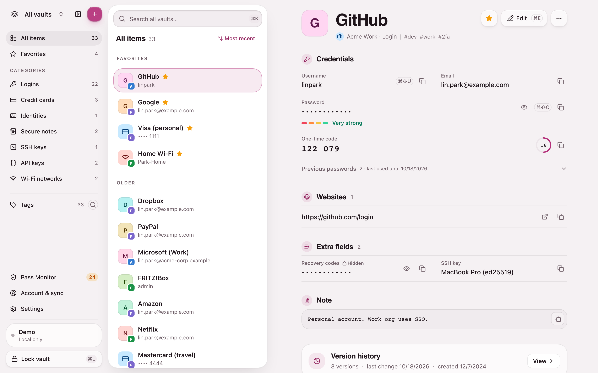

# passmgr

A full-stack, cross-platform, **offline-first** password manager built on **OPAQUE** zero-knowledge authentication. TypeScript monorepo, pnpm + Turborepo.

[](./LICENSE)

**[Try the live demo → passmgr.bastipnt.de](https://passmgr.bastipnt.de)**



> ⚠️ **Not a finished product — and not for real passwords yet.**
>
> It is far enough along to use and explore (see the demo), but the cryptographic stack has not been audited and the architecture, API and storage format still change. There are no migrations for old data: expect resets between versions. Treat this as a research / learning project.

## TL;DR

- **What:** a password manager for web and mobile (iOS / Android) with an optional sync server.
- **Zero knowledge:** [OPAQUE](https://datatracker.ietf.org/doc/draft-irtf-cfrg-opaque/) login means the server never sees your master password, not even in transit. Everything in a vault is encrypted on your device first (Argon2id + XChaCha20-Poly1305).
- **Local first:** start with a local vault on the device and no account; link it to an account later to sync. A vault works offline.
- **Try it:** [passmgr.bastipnt.de](https://passmgr.bastipnt.de) is a demo with example data. Everything stays in your browser; nothing is sent to a server.
- **Run it:** `pnpm install && pnpm db:up && pnpm db:migrate && pnpm dev` (needs Node, pnpm, Docker). See [Quick start](#quick-start).
- **Status:** works end to end, **unaudited**. License: AGPL-3.0.

## What it is

A password manager that uses OPAQUE (an asymmetric PAKE) so the server never learns your plaintext password. The account key is wrapped client-side by a key derived from your password and stored encrypted on the server; every record is encrypted with its vault's key.

### Key hierarchy

```
password ──Argon2id──► passwordKEK ──wrap──► accountKey
recoveryKey ──HKDF──► recoveryKEK ──wrap──► accountKey  (backup)
recoveryKey ──HKDF──► recoveryAuthKey ──SHA-256──► recoveryVerifier  (server, recovery proof)
accountKey ──wrap──► vaultKey[vaultId] ──encrypt──► records
accountKey ──wrap──► x25519PrivateKey  (vault sharing)

sessionKey ──HKDF──► sessionSecret ──HKDF(+salt)──► authKey  (HMAC request signing)
```

Email is stored encrypted (XChaCha20-Poly1305) and indexed via a server-keyed HMAC, never as plaintext. Details: [docs/architecture/auth.md](./docs/architecture/auth.md).

## What works today

- **Vaults and records**: several vaults per user, many record types (logins, cards, identities, secure notes, SSH / API keys, Wi-Fi), tags, favorites, search, trash, version history with diff, TOTP codes, password / passphrase generator, Pass Monitor (weak, reused, breached).
- **Auth**: OPAQUE registration and login, two-factor, recovery key, password change, biometric unlock (WebAuthn on web, Keychain / Keystore on mobile), account deletion.
- **Local vaults**: work without an account and offline, export / restore a backup, import from CSV, Bitwarden, 1Password (1PUX) and KeePass, link to an account later.
- **Sync and sharing**: delta sync with conflict merge, live change notifications, shared vaults with per-member roles.
- **Clients**: React web app (PWA, phone layout) and React Native / Expo mobile app, both with themes and accent colors.
- **Server and ops**: HMAC-signed requests with replay protection, rate limiting, per-account login back-off, strict CSP, served-code integrity checks, Prometheus metrics, Docker deployment.
- **Tests**: Vitest unit and integration suites, Playwright E2E, fuzz tests, nightly Stryker mutation testing.

## What's missing

- Independent security audit and a written threat model for the whole system.
- Desktop app and browser extensions (not started).
- Improvements for the web app and mobile apps.

## Stack

| Layer   | Tech                                                                  |
| ------- | --------------------------------------------------------------------- |
| Web     | React 19, Vite (rolldown-vite), Tailwind v4, wouter, tRPC client      |
| Mobile  | React Native, Expo, Uniwind (Tailwind v4 for RN)                      |
| Server  | Fastify 5, tRPC 11, Bun runtime, Drizzle ORM (1.0 beta)               |
| Data    | PostgreSQL 17, Redis 7                                                |
| Crypto  | `@cloudflare/opaque-ts`, `@noble/hashes`, `@noble/ciphers`            |
| Tooling | pnpm 10 workspaces, Turborepo, OXLint, Biome, Lefthook, commitlint    |

## Repo layout

```
apps/
  web/       React 19 + Vite web client
  mobile/    React Native + Expo client
  server/    Fastify + tRPC backend, runs on Bun
packages/
  client/             Shared React hooks (useLogin, useRegistration) + tRPC client
  crypto/             All cryptographic primitives
  db/                 Drizzle schema + migrations (PostgreSQL)
  schema/             Zod schemas shared between client and server
  store/              On-device SQLite (one DB per profile) + secrets store + sync
  ui-shared/          Design tokens (colors, spacing, radius) for web + native
  types/              Shared TypeScript types
  typescript-config/  Shared tsconfig base files
  ui/                 Shared web component library (shadcn-based)
  ui-native/          Mobile component library (Uniwind)
  util/               Base64 / string encoding helpers
```

## Quick start

You need: Node 18+, pnpm 10, Docker (for Postgres + Redis), and optionally Bun (server runtime).

```bash
pnpm install

# Start Postgres + Redis + Mailpit (catches mail, UI on http://localhost:8025)
pnpm db:up

# Run migrations
pnpm db:migrate

# Start everything in watch mode
pnpm dev
```

### Required env vars

Server (`apps/server/.env`):

| Var                   | Notes                                                                              |
| --------------------- | ---------------------------------------------------------------------------------- |
| `DATABASE_URL`        | PostgreSQL connection string                                                       |
| `REDIS_HOST`          | e.g. `localhost`                                                                   |
| `REDIS_PORT`          | e.g. `6379`                                                                        |
| `REDIS_PASSWORD`      | Redis `requirepass`; empty = no auth. Required in production.                      |
| `OPAQUE_SERVER_SETUP` | base64 OPAQUE server setup. **Must stay stable** — rotating invalidates all users. |
| `SMTP_URL`            | Mail for email verification; dev: `smtp://localhost:1025` (Mailpit). [docs/ops/email.md](./docs/ops/email.md) |
| `MAIL_FROM`           | Sender address, required with `SMTP_URL`                                           |

DB package (`packages/db/.env`):

| Var            | Notes                          |
| -------------- | ------------------------------ |
| `DATABASE_URL` | Same as above, used by Drizzle |

### Common scripts

```bash
pnpm dev              # all apps in watch mode
pnpm build            # build everything via turbo
pnpm lint             # OXLint, type-aware
pnpm typecheck        # tsc across the monorepo
pnpm test             # Vitest unit tests
pnpm test:integration # integration suites
pnpm e2e              # Playwright
pnpm format           # Biome (format + assists, writes)
pnpm db:generate      # Drizzle migration generation
pnpm db:migrate       # Drizzle migration apply
```

Per-app:

```bash
pnpm --filter web dev
pnpm --filter server dev
pnpm --filter mobile start
```

## Per-app docs

- [apps/web/README.md](./apps/web/README.md)
- [apps/mobile/README.md](./apps/mobile/README.md)
- [apps/server/README.md](./apps/server/README.md)

## Contributing

PRs welcome — see [CONTRIBUTING.md](./CONTRIBUTING.md). Open an issue before tackling anything large; the architecture is still in motion.

## Security

**Do not file public issues for security problems.** See [SECURITY.md](./SECURITY.md) for the private disclosure path.

The crypto stack is **unaudited**.

## License

[AGPL-3.0-only](./LICENSE). You can self-host and modify freely; if you run a modified version as a network service, you must publish your source under the same license.
